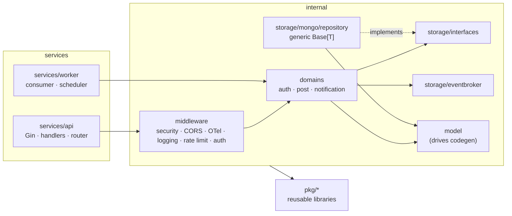
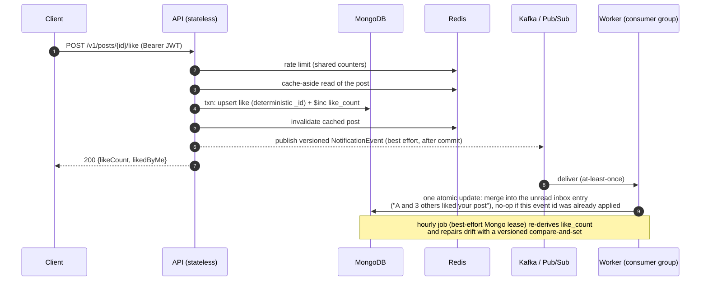

# XSocial — Go backend architecture showcase

> **What this repository is.** The architectural core extracted from the backend of a
> production platform: a Go monorepo running an API service and an event-driven worker on
> MongoDB, Redis and Kafka / Cloud Pub/Sub.
>
> Product and business logic were deliberately removed. What is left is **the skeleton the
> full system is built on** — layering, dependency injection, storage and messaging
> abstractions, error model, configuration, observability, code generation, tests and
> CI/CD — plus **one vertical slice** (post → like → asynchronous notification) that
> exercises every one of those pieces end to end, so the design can be read *and* run.
>
> It runs single-node with `docker compose`. The production topology it was designed for
> (horizontally scaled stateless API, consumer groups, managed data stores, serverless media
> pipeline) is described in **[docs/ARCHITECTURE.md](docs/ARCHITECTURE.md)**.

**Live demo: [xsocial.dev](https://xsocial.dev/)** runs the complete platform this core was
extracted from — web client and full backend, seeded with demo content. Sign up with a
username and password to try it.

## Design background

I began exploring the ideas behind this project about five years ago, drawing on lessons
from earlier projects, and the design has gone through several rounds of implementation,
testing and refinement since. Three concerns shaped it: correctness under concurrent load,
room for a growing product and team, and a system that stays maintainable as it changes.

---

## 60-second tour for reviewers

| If you want to see… | Look at |
|---|---|
| MongoDB + Redis + Kafka cooperating in one use case | [`internal/domains/post/biz.go`](internal/domains/post/biz.go) (`Like`) |
| At-least-once delivery made idempotent by a unique index, not a lookup (one atomic merge keyed by event id) | [`internal/domains/notification/biz.go`](internal/domains/notification/biz.go), [`repository/notification.go`](internal/storage/mongo/repository/notification.go) |
| A consumer that retries in place and never skips a message | [`internal/storage/eventbroker/kafka_consumer.go`](internal/storage/eventbroker/kafka_consumer.go) |
| Counter reconciliation protected against ABA by versioned compare-and-set; best-effort lease coordination | [`services/worker/jobs`](services/worker/jobs/reconcile.go), [`repository/job_lease.go`](internal/storage/mongo/repository/job_lease.go) |
| Transactions proven, not assumed (rollback test on a real replica set) | [`repository/integration_test.go`](internal/storage/mongo/repository/integration_test.go), [`mongotest`](internal/testutil/mongotest/mongotest.go) |
| Layering, and how it is **enforced** (not just documented) | [`scripts/check-arch.sh`](scripts/check-arch.sh), [`internal/storage/interfaces`](internal/storage/interfaces/repository.go) |
| Compile-time dependency injection, one object graph per process | [`internal/wire/providers.go`](internal/wire/providers.go), [`services/api/wire/wire.go`](services/api/wire/wire.go) |
| Testing strategy (fakes → real DB → HTTP E2E) | [`internal/testutil/fake`](internal/testutil/fake/fake.go), [`services/api/tests/e2e_test.go`](services/api/tests/e2e_test.go) |
| Code generation from models, with drift checks | [`tools/mongo-codegen`](tools/mongo-codegen), [`Taskfile.yaml`](Taskfile.yaml) (`gen`, `gen:check`) |
| Coordinating changes, upgrades and handoffs across services | [`docs/ENGINEERING.md`](docs/ENGINEERING.md) |
| CI and CD | [`.github/workflows/ci.yml`](.github/workflows/ci.yml), [`.gitlab-ci.yml`](.gitlab-ci.yml) |

---

## Architecture at a glance



Dependencies only point inward. Domains see **interfaces**, never concrete repositories;
`pkg/*` never imports `internal/*`; `internal/*` never imports `services/*`. These rules
run in the pre-commit hook and in CI.

### The vertical slice: one "like", every component



---

## Engineering for long-term ownership

I designed the shared structure and workflows to make a multi-service project easier to
change, validate and hand over. The goal is to reduce routine coordination work and make
important engineering rules visible in the repository:

- **Executable standards.** Formatting, linting, dependency rules and commit conventions
  make routine checks repeatable, leaving code review focused on behavior, correctness and
  design. Local hooks provide early feedback and check commit messages; CI re-runs the code
  checks on the submitted tree independently.
- **Repeatable workflows.** Taskfile exposes common development commands. Generators keep
  MongoDB field constants, dependency wiring and API documentation aligned with their
  sources; drift checks catch output that was not committed with a change.
- **Explicit boundaries.** Business services consume repository and broker interfaces;
  implementations are wired at startup. This contains provider-specific behavior and
  enables isolated tests. Replacing a database still requires work on queries, transactions
  and data migration.
- **Coordinated service evolution.** The monorepo keeps shared models, libraries and tooling
  together, so related API and worker changes can be reviewed in one commit. Each service
  retains its own entry point, dependency graph and image build target.
- **Maintenance backed by evidence.** A runnable vertical slice, architecture documentation
  and regression tests for concurrency and failure scenarios give the next maintainer a
  starting point for understanding and safely changing the system.

See [Engineering decisions](docs/ENGINEERING.md) for the rationale, trade-offs and code
references. [Architecture](docs/ARCHITECTURE.md) covers runtime behavior, consistency and
deployment.

## What the code demonstrates

### Architecture and design

- **Clean / DDD-style layering** — `services → middleware/handlers → domains → interfaces ← repositories`, with domain-owned error sentinels mapped to a stable `{code, message}` API contract in exactly one place ([`apierrors`](internal/apierrors/domain_converter.go)). Unknown errors never leak internal text.
- **Dependency injection with Google Wire** — shared provider sets (`InfraSet`, `RepositorySet`, `DomainSet`) composed per service; `wire.Bind` maps interfaces to implementations; one constructor builds the whole graph or fails (no half-initialised process).
- **Thin handlers, explicit auth modes** — routes are grouped as `Forbidden` (guest-only), `Optional` (personalised public reads) or `Required`, instead of ad-hoc checks inside handlers.
- **Generic repository** — `Base[T]` provides typed CRUD, context-aware logging and `WithTransaction` that **falls back gracefully** on a standalone MongoDB (dev) while using real multi-document transactions on a replica set (prod, and CI — where a rollback test proves it).

### Data and middleware, used for what each is good at

- **MongoDB**: idempotent writes via deterministic `_id` + `$setOnInsert` upsert (no check-then-act race — verified by a 32-goroutine integration test); **aggregation-pipeline updates** for conditional array merges; **keyset pagination** on time-ordered Snowflake IDs; **indexes declared in code** next to the queries that need them, including a **unique partial index used as a concurrency primitive** (one unread inbox entry per target); logical → physical database mapping per environment.
- **Redis**: generic **cache-aside** (`cache.Aside[T]`, fail-open, hit/miss metrics) with write-path invalidation — eventually consistent within the 5-minute TTL, while the like/unlike response reads MongoDB so the actor always sees their own write; **distributed rate limiting** with per-device keys capped by a per-IP ceiling. Namespaced keys only (`cache.Key`). Nothing that must be correct lives only in Redis.
- **Kafka / Cloud Pub/Sub** behind one `eventbroker.Publisher/Handler` interface, switched by config; **versioned event payloads**; at-least-once delivery handled by an **idempotent consumer** — every inbox entry records the event ids it absorbed and a **unique index over (uid, event_ids)** spans read and unread entries, so the database itself refuses any insert or merge that would apply an event twice: no lookup, no check-then-act window, no second store; redelivery (even after the recipient has read the inbox) and concurrent workers are safe; a failing message is retried in place and **never skipped** (Kafka offsets commit cumulatively, so skipping one would drop it).

  De-duplication applies while an ID is retained: each entry keeps its newest 1,000 event
  IDs. Older IDs can be applied again after eviction; events with ID zero are not
  deduplicated. Publication after the business transaction is best-effort; an outbox and
  a dead-letter path remain future work, as described in [Architecture](docs/ARCHITECTURE.md).
- **Snowflake IDs** (Sonyflake) with explicit datacenter/worker allocation; 64-bit IDs serialised as strings for JavaScript clients.
- **Auth**: bcrypt, **EdDSA (Ed25519) JWTs**, access/refresh audience separation, `kid` header and **zero-downtime key rotation** (`previous_keys`), no username enumeration.
- **Observability**: OpenTelemetry tracing + metrics (Prometheus exporter on a private port), zap structured logs carrying the request context, business metrics such as `notification_merged_total`, `notification_duplicate_total` and `reconciliation_like_count_drift_total`.

### Verification and delivery

- **Test pyramid** — domain tests use in-memory fakes; integration tests use real MongoDB and Redis. Replica-set tests exercise rollback, concurrent likes and notification events, redelivery across read entries, versioned CAS and job leases. HTTP E2E uses the real router, business logic and MongoDB, with an in-memory publisher feeding the notification handler; it does not test broker transport. Tests run with `-race` in CI.
- **CI/CD** — GitHub Actions: format, architecture rules, golangci-lint, generated-code drift, unit, integration against a MongoDB replica set and Redis, multi-service image build with layer cache, push on tags. GitLab CI (reference pipeline for self-hosted runners): path-filtered builds per service, BuildKit registry cache, SSH rollout to a dev host with a health-check gate for the API, and a manual, tag-only production job that is a placeholder to wire to the target environment.
- **Version configuration** — [`versions.env`](versions.env) centralizes the main toolchain and infrastructure versions consumed by local builds and CI. GitLab variables are generated from it and checked for drift; upgrade checks also need to cover independently declared versions such as Go module requirements and CI actions.

### Operability and security

- **Fail-fast configuration**: release mode refuses to start with a weak JWT key or with rate limiting disabled; layered YAML (`default → env`) with `${VAR:-default}` expansion and env binding; secrets only from the environment.
- **Graceful shutdown** (HTTP drain, consumer stop, scheduler stop before the stores close, producer flush, telemetry flush); `/status` and build-stamped `/version` on the API.
- **Trusted-proxy aware client IP**, security headers (HSTS in release), strict CORS.
- **Containers**: multi-stage, `-trimpath`, BuildKit caches, non-root user, health check, version metadata via `-ldflags`, no secrets or `.env` baked into images.

---

## Repository layout

```text
services/
  api/            HTTP service: main, router (routes + rate-limit policy table), thin handlers, Wire injector, E2E tests
  worker/         Event consumer (Kafka or Pub/Sub) + interval scheduler with best-effort Mongo lease coordination
internal/
  domains/        Business rules: auth, post, notification (depend on interfaces only)
  storage/
    interfaces/   Repository contracts consumed by domains
    mongo/        Client, indexes-as-code, generated field/collection constants, repositories (Base[T])
    redis/ cache/ eventbroker/
  model/          MongoDB documents (input of the code generator)
  middleware/     Security headers, CORS, request context, logging, rate limiting, auth modes
  apierrors/      Domain/internal error → API error mapping
  config/ dep/ wire/ http/ ratelimit/ version/ errors/
  testutil/       In-memory fakes, throw-away MongoDB helper
pkg/              Reusable libraries (cache, eventbroker, idgen, logger, otelutil, server, ratelimit, utils, …)
tools/            mongo-codegen, CI variable generator
scripts/          Architecture rules
configs/          default / test / stg / prod overrides
dev/docker/       Local MongoDB, Redis, Kafka (+Kafdrop), Jaeger
docs/             ARCHITECTURE.md, ENGINEERING.md, generated OpenAPI
```

---

## Run it

Requirements: Go 1.26, Docker, [Task](https://taskfile.dev) and `jq` (used by the example below).

```bash
cp .env.example .env
task dev:up            # MongoDB, Redis, Kafka (+Kafdrop :9000), Jaeger (:16686) — localhost only
task run:api           # terminal 1: http://localhost:8080 (Swagger UI: /swagger/index.html in debug mode)
task run:worker        # terminal 2: consumes notification events, runs the reconciliation job
```

Wait until the worker logs `ConsumeClaim started` before producing events: a new consumer
group starts at the end of the topic and does not replay earlier events.

```bash
B=http://localhost:8080/v1
A=$(curl -s -XPOST $B/auth/signup -d '{"username":"alice_01","password":"s3cret-pass"}' | jq -r .accessToken)
BOB=$(curl -s -XPOST $B/auth/signup -d '{"username":"bob_0001","password":"s3cret-pass"}' | jq -r .accessToken)
P=$(curl -s -XPOST $B/posts -H "Authorization: Bearer $A" -d '{"content":"hello"}' | jq -r .id)
curl -s -XPOST $B/posts/$P/like -H "Authorization: Bearer $BOB"      # idempotent: try it twice
sleep 1                                                               # the worker applies the event asynchronously
curl -s $B/notifications -H "Authorization: Bearer $A"
```

### Quality gates and tests

```bash
task check             # fmt, architecture rules, golangci-lint, tagged tests compile, generated-code drift
task test:unit         # all unit tests, -race, no external services
task test:integration  # real MongoDB / Redis (uses the dev stack), includes HTTP E2E
task gen               # regenerate Mongo constants, Wire, OpenAPI
```

`task check` needs `goimports` and golangci-lint v2.9 built with Go 1.26 or newer — a binary
built with an older Go refuses to lint this module:

```bash
go install golang.org/x/tools/cmd/goimports@latest
go install github.com/golangci/golangci-lint/v2/cmd/golangci-lint@v2.9.0
```

The Git hooks (pre-commit gate, commit-message check) are optional and need Node 24
(`.nvmrc`): `npm install` installs husky and commitlint.

The dev stack runs MongoDB standalone, so the transaction tests skip locally; CI starts a
single-node replica set and `CI_STRICT_INTEGRATION=1` turns those skips into failures.

### Scale-out profile

```bash
task dev:cluster       # 2 API + 2 worker replicas on the same stack, distinct Snowflake worker ids, 2 Kafka partitions
curl -s localhost:8101/status && curl -s localhost:8102/status
task dev:cluster:down
```

Both APIs share the Redis rate-limit counters and the post cache; the two workers share the
`notification-worker` consumer group (one partition each) and take turns on the reconciliation
job through the Mongo lease. The same request sequence as above works against either port;
give the workers a few seconds to join the group first (`docker logs xsocial-worker-1-1`
shows `ConsumeClaim started`), because a brand-new consumer group starts at the tail of the
topic and does not replay events produced before it existed.

---

## Single node here, distributed in production

This repository runs every component on one machine so it can be cloned and executed in
minutes. The same code is built for a distributed deployment, and several choices only make
sense there — stateless API processes, shared Redis counters for rate limiting, consumer
groups, per-instance Snowflake worker IDs, idempotent consumers, shard-friendly keys,
trusted-proxy handling behind a load balancer. [docs/ARCHITECTURE.md](docs/ARCHITECTURE.md)
covers the production topology, scaling and failure modes, consistency trade-offs and the
next steps (transactional outbox, dead-letter queues).

---

Code in this repository is published for review and evaluation purposes only — see [LICENSE](LICENSE).
