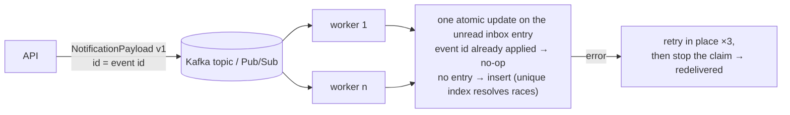
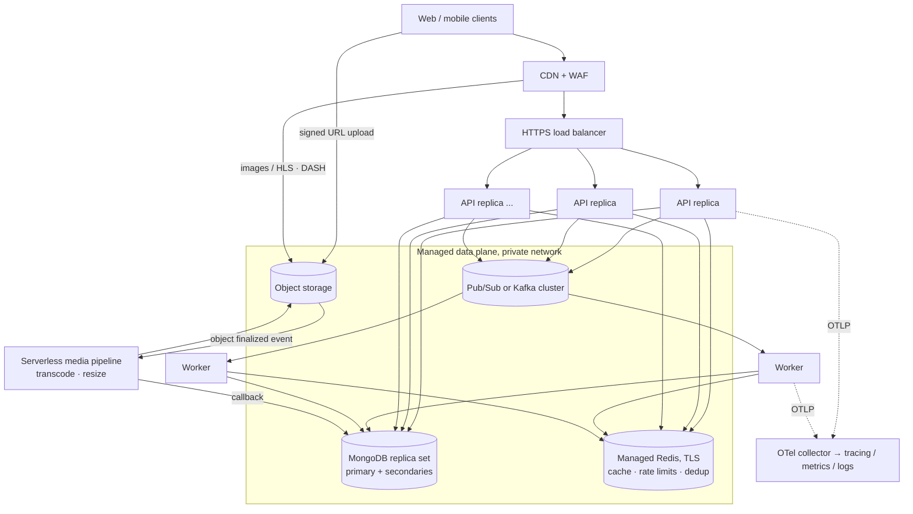

# Architecture

This document explains how the code in this repository is organised, why, and how the
same code runs as a distributed system in production. The repository itself is a
single-node, runnable extract of a larger platform (see the [README](../README.md));
sections marked **Full system** describe parts that exist in the original product but
were removed here, and **Next steps** are known gaps with a planned design.

- [1. Layers and dependency rules](#1-layers-and-dependency-rules)
- [2. Process model](#2-process-model)
- [3. Request lifecycle](#3-request-lifecycle)
- [4. Write path and consistency](#4-write-path-and-consistency)
- [5. Asynchronous pipeline](#5-asynchronous-pipeline)
- [6. Data model and MongoDB](#6-data-model-and-mongodb)
- [7. Production topology](#7-production-topology)
- [8. Scaling and failure modes](#8-scaling-and-failure-modes)
- [9. Security](#9-security)
- [10. Delivery pipeline](#10-delivery-pipeline)
- [11. Trade-offs and next steps](#11-trade-offs-and-next-steps)

---

## 1. Layers and dependency rules

| Layer | Package(s) | Knows about | Must not know about |
|---|---|---|---|
| Process entry | `services/api`, `services/worker` | everything below | — |
| HTTP edge | `services/api/handlers`, `router`, `internal/middleware`, `internal/http`, `internal/apierrors` | domains | storage implementations |
| Domain | `internal/domains/*` | `storage/interfaces`, `model`, `pkg/*`, other domains' public APIs | HTTP, Wire, concrete repositories |
| Storage contracts | `internal/storage/interfaces` | `model` | domains |
| Storage adapters | `internal/storage/{mongo,redis,cache,eventbroker}` | `model`, `pkg/*` | domains, HTTP |
| Model | `internal/model` | `pkg/*` | every other layer |
| Libraries | `pkg/*` | the standard library and third parties | anything in `internal/` |

The rules are executable: [`scripts/check-arch.sh`](../scripts/check-arch.sh) runs in the
pre-commit hook and CI, and golangci-lint's `depguard` independently forbids
`pkg/ → internal/`. A violation fails the build rather than a code review.

Why this shape:

- **Domains depend on interfaces.** The post domain is unit-tested against in-memory fakes
  (`internal/testutil/fake`) in milliseconds; the Mongo adapters are tested separately
  against a real database. Swapping a store, or putting a cache in front of one, does not
  touch business code.
- **Errors flow outward, mapping happens once.** Domains return their own sentinels
  (`post.ErrPostNotFound`); `internal/apierrors` is the single table that maps them to HTTP
  status + business code. Unknown errors become a generic 500 and are logged, never echoed.
- **Wire builds one object graph per process.** Providers are grouped into shared sets
  (`internal/wire`) that both services compose, so the API and the worker construct
  domains identically. `wire.Bind` is where interfaces meet implementations. Generated
  constructors are committed and checked for drift.

## 2. Process model

| Process | Responsibilities | State |
|---|---|---|
| **API** (`services/api`) | HTTP, authentication, validation, synchronous writes, publishing domain events | Stateless — scale horizontally |
| **Worker** (`services/worker`) | Consuming events (Kafka consumer group or Pub/Sub pull subscription), notification merging, scheduled jobs (counter reconciliation) | Stateless — scale by partitions / subscription parallelism |

Both processes share `internal/` and boot through the same `dep.BaseDeps`, which opens
only the MongoDB databases the service declares (`config.ServiceDatabaseRequirements`),
the cache, and the logger, and owns graceful shutdown.

Startup is fail-fast: in release mode a weak JWT signing key or disabled rate limiting
aborts the process; indexes are ensured before the HTTP server accepts traffic.

## 3. Request lifecycle

Middleware order (outermost first) and what each guarantees:

1. **Security headers** — every response, including errors and preflights; HSTS in release.
2. **CORS** — explicit origins per environment; no wildcards in release.
3. **OpenTelemetry** — span per request, trace id propagated to logs.
4. **Request context** — request id, client IP (only trusted proxies may set
   `X-Forwarded-For`), device id, language; a request-scoped logger in `context`.
5. **Access logging** — structured (zap), status + business code + latency.
6. **Rate limiting** (`/v1` only) — global per-IP bucket plus named policies; device-scoped
   keys are additionally capped per IP so rotating `X-Device-ID` cannot bypass limits.
   Storage is in-process for dev and **Redis in production so limits hold across replicas**.
   Policy *paths* live in code next to the routes; config only tunes numbers.
7. **Auth mode** per route group — `Forbidden` (guest-only), `Optional`, `Required`.
8. **Handler** — bind + validate, call one domain method, map the result.

## 4. Write path and consistency

The like operation is the reference write path:

```text
load post            cache-aside (Redis → MongoDB on miss), 404 if absent
transaction {        MongoDB multi-document transaction on a replica set
  upsert post_like   _id = "<postID>:<uid>", $setOnInsert  → created? (idempotent)
  if created: $inc post.like_count
}
invalidate cache     DEL post:<id>
publish event        only if created and actor ≠ author; failure is logged, not returned
```

Decisions and their reasons:

- **Idempotency by construction.** A deterministic `_id` plus `$setOnInsert` makes a
  repeated like a no-op without a read-before-write race. Retries, double clicks and
  at-least-once clients are safe; a 32-goroutine integration test pins this.
- **Counter + relation in one transaction** where the deployment supports it. On a
  standalone MongoDB (local dev) `WithTransaction` falls back to sequential writes and
  logs it; the reconciliation job (§5) repairs any drift that window could create.
- **Invalidate, don't update, the cache** after commit — simpler than keeping two copies in
  step, but not airtight: a reader that loaded the post before the commit can write the
  old copy back after the invalidation (the classic cache-aside race). Cached posts are
  therefore eventually consistent, bounded by the TTL (5 minutes). The like/unlike
  response is read from MongoDB, so the actor always sees their own write.
- **Repair is a versioned compare-and-set.** Every like and unlike bumps `like_version`
  along with `like_count`. The reconciliation job (§5) corrects the counter only if the
  version is still the one it read, so a write that lands mid-run is never overwritten —
  including a like followed by an unlike, which restores the value but not the version
  (no ABA). The next run sees consistent data again.
- **Event publication is best-effort after commit.** The user-visible action must not fail
  because the broker is down. The cost is that an event can be lost between commit and
  publish — see the transactional outbox in [Next steps](#11-trade-offs-and-next-steps).

## 5. Asynchronous pipeline



- **Pluggable broker.** `pkg/eventbroker` defines `Publisher` / `Handler`; Kafka (sarama
  consumer group) and Cloud Pub/Sub (pull) implement it. The broker is chosen by config;
  domains only see the interface. Local development and CI use Kafka in docker-compose,
  managed environments use Pub/Sub.
- **Versioned payloads.** Every event carries `version`, so consumers can branch during a
  schema migration and producers and consumers can be deployed independently.
- **Idempotent consumer, enforced by an index.** Delivery is at-least-once. Every inbox
  entry records the event ids it has absorbed, and a **unique multikey index over
  `(uid, event_ids)`** spans every entry of the recipient, read or unread. The merge is
  one aggregation-pipeline update: a redelivery to the same entry is a no-op (`$in`
  guard), and an insert or merge that would record an id already held by another entry —
  typically one the recipient has read since — is refused by the index, atomically. There
  is no lookup whose answer could go stale between "check" and "write", so a delivery that
  interleaves with "mark as read", a redelivery after a crash, a duplicate from a rebalance
  or two workers racing on the same entry all converge without a claim, a lock or a
  transaction. Two explicit limits: an event without an id (`EventID == 0`) is not
  deduplicated at all, and each entry keeps only its newest 1000 ids, so a redelivery
  older than 1000 newer events on the *same* entry would be counted again (brokers
  redeliver within seconds).
- **One unread entry per target, by index.** Events for the same
  `(recipient, action, target)` merge into the single unread entry until the recipient
  reads it; a unique partial index on unread entries enforces that invariant, so the
  "no entry yet" race between two workers is resolved by the database (the loser's insert
  fails and it merges). `who` keeps up to N distinct actors (`$cond`/`$concatArrays`),
  `who_count` counts every event — "A and 3 others liked your post" with bounded document
  size for viral content.
- **Failures are retried, never skipped.** Kafka offsets commit cumulatively per
  partition, so "skip this message, mark the next" would silently drop the failed one.
  The consumer retries a message in place with backoff and, if it still fails, stops the
  claim: the session ends and consumption resumes from the last committed offset, i.e.
  the message comes back. A poison message therefore pauses its partition until it
  succeeds or a dead-letter path exists (§11). Pub/Sub simply `Nack`s.
- **Reconciliation.** Denormalised counters are a cache of a source of truth. An interval
  scheduler (one goroutine per job, panic-isolated, runs on start then every interval)
  recomputes `like_count` from `post_like` in pages using an aggregation, repairs drift
  with a compare-and-set (§4), invalidates the cached post, and exports the drift as a
  metric so it is alertable. It is idempotent and has a dry-run mode.
- **One runner per interval, best effort.** Every worker replica runs the scheduler, but
  a job only runs on the replica that holds its lease: a MongoDB document keyed by job
  name, taken with one conditional upsert, renewed by a heartbeat while the job runs and
  held until it expires (TTL = the interval). A lease-store error skips the run; a refused
  renewal cancels the running job. Overlap is still possible at the edges — a crashed
  holder's lease lapses only after one interval, a cancelled run may have a write in
  flight — so every job must tolerate a concurrent runner; the reconciler's versioned
  compare-and-set makes that harmless. No extra infrastructure.

## 6. Data model and MongoDB

- **Snowflake IDs** (64-bit, time-ordered) for every document: no coordination on insert,
  natural sort order, and `_id` doubles as the keyset-pagination cursor. Each process needs
  a unique `(datacenter, worker)` pair — assigned per instance by the deployment.
- **Code-generated field constants** (`field.Post.LikeCount`) instead of string literals in
  BSON queries; renaming a field is a compile error, not a silent bug.
- **Indexes as code** (`internal/storage/mongo/indexes`), ensured at startup, reviewed with
  the queries that need them, and exercised by integration tests.
- **Logical vs physical database names** — code uses `xs_db`; configuration maps it per
  environment (`xs_db → xs_test` in tests), and per service (API vs worker vs analytics).

**Full system.** Collections are designed with a sharding key in mind (user id for
per-user data such as inbox and timeline, `_id` for content). The home timeline uses
**fan-out on write** into a per-user feed collection with a TTL, combined with
scatter-gather over followed users for accounts with very large follower counts.

## 7. Production topology



- **Stateless API replicas behind a load balancer**, autoscaled on CPU/latency. Nothing is
  kept in process memory that another replica needs: sessions are JWTs, rate-limit counters
  and caches live in Redis, IDs come from per-instance Snowflake workers.
- **Workers scale independently** of the API: Kafka partitions (keyed by event id) or Pub/Sub
  subscription concurrency bound parallelism; idempotent handlers make rebalancing and
  redelivery safe.
- **Managed data plane on a private network**: MongoDB replica set (transactions,
  `majority` writes, primary reads for read-your-writes), managed Redis with TLS, managed
  broker. No data store has a public endpoint.
- **Full system — media pipeline.** Clients upload straight to object storage with
  short-lived signed URLs (the API never proxies large bodies). An object-finalized event
  triggers serverless workers that transcode video to adaptive HLS/DASH and resize images;
  a callback marks the media ready; the CDN serves the results.
- **Observability**: OTLP from every process to a collector, traces correlated with logs
  by trace id, Prometheus metrics on a private port, business metrics (cache hit ratio,
  notification merges, reconciliation drift) next to RED metrics.
- **Configuration and secrets**: one image per commit promoted across environments; the
  environment selects `config.<env>.yaml`; secrets are injected from a secret manager as
  environment variables, never baked into images.

## 8. Scaling and failure modes

| Failure / pressure | Behaviour |
|---|---|
| API replica dies | LB health checks remove it; no session or counter state is lost |
| Redis unavailable | Cache-aside fails open to MongoDB; consumers are unaffected (idempotency lives in MongoDB); rate limiting is the one dependency that should alert immediately |
| Broker unavailable | Writes still succeed; events from that window are lost until an outbox exists (§11) |
| Worker crash mid-event | Message not acked → redelivered; if the first attempt had already committed, the redelivery is a no-op (event id on the entry) |
| Duplicate / replayed events | No-op: the unique event index refuses a second record of the id on any entry, read or unread (newest 1000 ids kept per entry) |
| Poison message | Retried 3× in place, then its partition pauses and the message is redelivered after the session restarts — never skipped (dead-letter path: §11) |
| Counter drift (partial failure, no-txn deployment) | Detected and repaired by the reconciliation job with a versioned compare-and-set (ABA-safe), on one replica per interval; drift metric alerts |
| Worker scale-out | Partitions / subscription concurrency bound parallelism; concurrent events for one inbox entry serialise on the document; the scheduled job runs on whichever replica holds the lease |
| Hot post (viral) | Post served from cache; notification `who` array bounded; counters use `$inc` (no read-modify-write) |
| Signing-key compromise / rotation | New key deployed with the old one in `previous_keys`; old one removed after the refresh TTL |
| Traffic spike on auth endpoints | Per-device + per-IP limits in shared Redis; release mode refuses to run without them |

## 9. Security

- Passwords: bcrypt. Login errors are identical for unknown users and wrong passwords.
- Tokens: EdDSA (Ed25519) JWTs derived from a high-entropy secret, `kid` header, access and
  refresh audiences are not interchangeable, key rotation without downtime. Release mode
  rejects weak keys at startup.
- Authorisation is part of the data access, not an afterthought: e.g. marking a
  notification read filters by `(id, uid)`, so a foreign id is indistinguishable from a
  missing one.
- Client IP is trusted from `X-Forwarded-For` only when the peer is a configured proxy.
- Security headers on every response, strict CORS, no data store exposed publicly,
  containers run as a non-root user with no secrets in the image.

## 10. Delivery pipeline

```text
commit ─► pre-commit hook: regenerate code · architecture rules · fmt · lint (staged)
       ─► commit-msg: commitlint "[project] type(scope): subject"
push   ─► CI: fmt · arch · golangci-lint · generated-code drift · versions drift
          unit (-race) · integration + E2E on a MongoDB replica set + Redis · images (cache)
main   ─► build image once per commit → registry (BuildKit registry cache)
          → roll out to dev, path-filtered per service (API behind a health-check gate)
tag    ─► manual production job (a placeholder in this extract, to wire to the target environment)
```

**Unified version management**: `versions.env` is the only file where Go, Alpine, MongoDB,
Redis, Kafka, Jaeger, golangci-lint, swag and Wire versions are written. Taskfile loads it
(Docker build args, generator versions), docker-compose reads it for local images, GitHub
Actions exports it into the job environment, and the GitLab variables file is generated
from it by the pre-commit hook; CI fails if they diverge. Upgrading a dependency across
laptops, CI and production images is a one-line change.

## 11. Trade-offs and next steps

| Topic | Current choice | Why | Next step |
|---|---|---|---|
| Event publication | Best-effort after commit | User action never fails on broker outage | **Transactional outbox**: write the event in the same transaction, relay asynchronously |
| Poison messages | Retried in place, then the partition pauses until the message succeeds | At-least-once with no second store; nothing is ever dropped silently | **Dead-letter topic/subscription** with max delivery attempts + alert |
| Consumer idempotency | Event ids recorded on the inbox entry in the same atomic update (newest 1000), with a unique index over (uid, event_ids) across read and unread entries | Enforced by the database, not by a lookup; crash-safe without a transaction, a lock or a second store | A processed-events collection with a unique index if unbounded history is ever required |
| Scheduled jobs | MongoDB lease with heartbeat, fail-closed; jobs tolerate overlap | No extra infrastructure; a dead replica's lease lapses | Leader election by the orchestrator (e.g. a CronJob) |
| Counters | Denormalised + reconciliation | O(1) reads on hot paths | Sharded counters if a single document becomes a write hotspot |
| Pagination | Keyset on Snowflake `_id` | Stable under inserts, index-only | Opaque, signed cursors |
| Cache | Per-entity cache-aside, explicit invalidation; stale window up to the TTL after a racing read | Predictable, easy to reason about; the actor reads its own write from MongoDB | Versioned entries (refuse to cache a copy older than `like_version`); request coalescing (singleflight) for thundering-herd protection |
